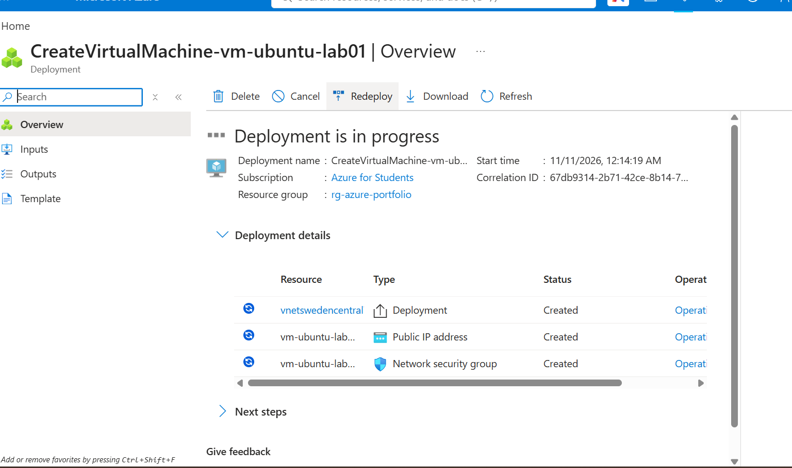

# Lab 01 — Deploy an Ubuntu Virtual Machine in Azure

## Objective
Create a Linux virtual machine using Azure Portal and document the deployment workflow.

## Environment
- Subscription: Azure for Students
- Resource group: `rg-azure-portfolio`
- VM name: `vm-ubuntu-lab01`
- Region: Sweden Central
- Operating system: Ubuntu Server 24.04 LTS
- VM size: Standard B2ats_v2
- Authentication: SSH public key

## Steps performed
1. Created the resource group `rg-azure-portfolio`.
2. Configured an Ubuntu VM in Azure Portal.
3. Reviewed the deployment configuration and pricing.
4. Started the deployment.

## Evidence

**Status at capture:** Deployment in progress. The screenshot does not confirm a successful VM deployment.

## Next steps
- Confirm Azure reports **Your deployment is complete**.
- Capture a deployment-success screenshot (after hiding sensitive information).
- Review inbound network rules before connecting with SSH.
- Optionally install and verify NGINX; document results only after testing.
- Stop/deallocate or delete unused resources to manage costs.

## Lessons learned
Azure resource groups organize related resources. VM deployment may create networking resources such as public IP addresses and network security groups. Deployment progress and successful provisioning are different states.
